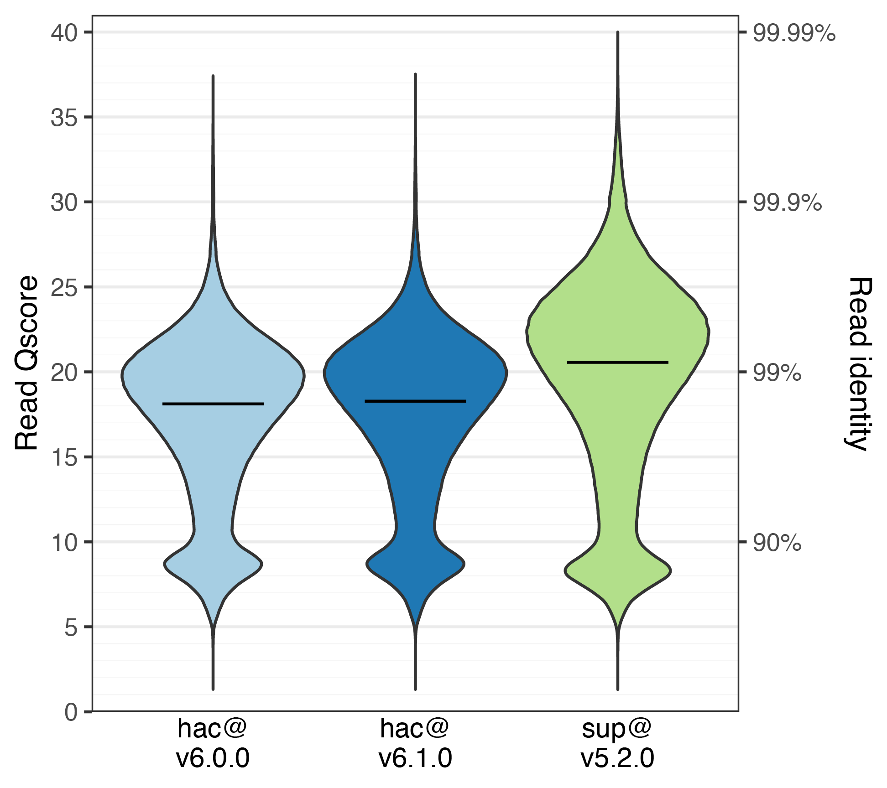
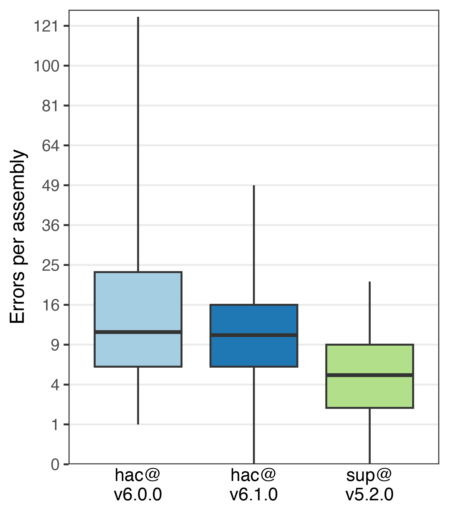
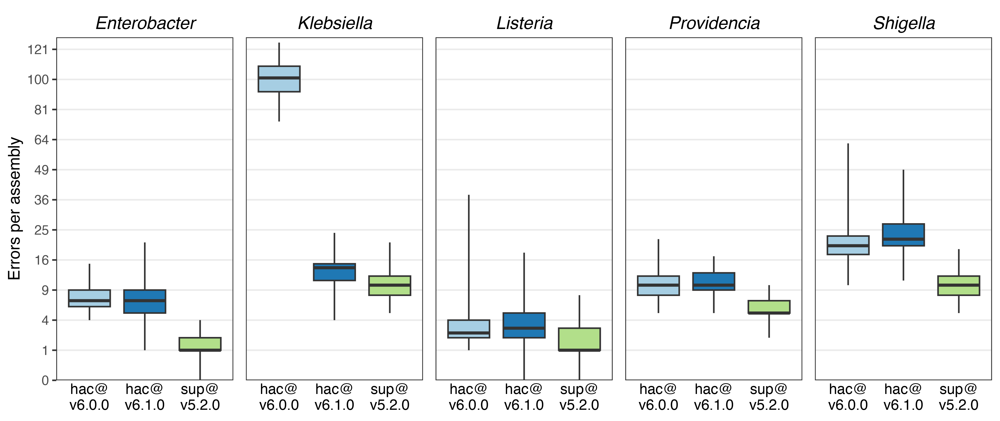
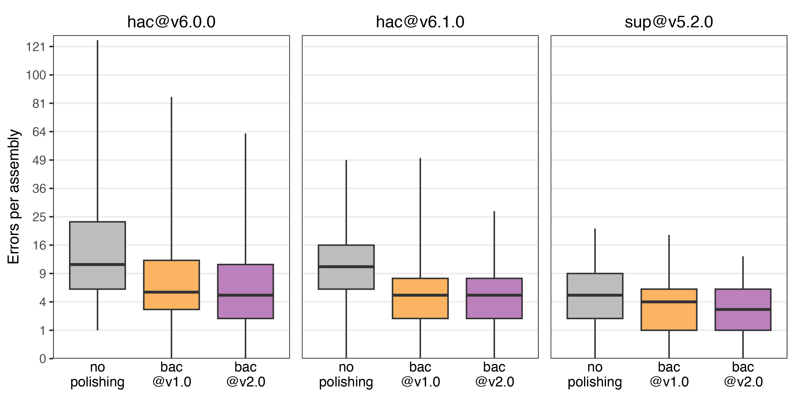

Earlier this year, ONT released a new hac basecalling model: `hac@v6.0.0`. But in some [previous](https://rrwick.github.io/2026/06/11/dorado-v2.html) [posts](https://rrwick.github.io/2026/06/19/dorado-v2-polishing.html), I saw that it performed quite poorly on my _Klebsiella_ test sample. The reason was unclear until Michael Biggel contacted me with a plausible explanation: 7-deazaguanine modifications. [Michael's preprint](https://www.biorxiv.org/content/10.64898/2026.03.20.713089v2) shows how the `hac@v6.0.0` basecalling model struggles with both 7-deazaguanine and phosphorothioation.

ONT has now released [Dorado v2.2.0](https://github.com/nanoporetech/dorado/releases/tag/v2.2.0), which has an updated model to address these problems: `hac@v6.1.0`. In this post, I use the same samples from those previous posts to test `hac@v6.1.0`[^earlyaccess]. My first goal is to compare `hac@v6.0.0` to `hac@v6.1.0`. Does the new basecalling model fix the _Klebsiella_ accuracy issue? My second goal is to see how `hac@v6.1.0` compares to `sup@v5.2.0`. There is no current-gen sup model, so should users stick with `sup@v5.2.0` or move to `hac@v6.1.0`?

ONT also has a new bacterial polishing model for [Medaka](https://github.com/nanoporetech/medaka) and [Dorado polish](https://software-docs.nanoporetech.com/dorado/latest/secondary/polish/)[^medaka_dorado]. So I'll also assess how that compares to the older model it's replacing. The polishing model names are a bit confusing. In Medaka, the old model is called `r1041_e82_400bps_bacterial_methylation` and the new model is `r1041_e82_400bps_bacterial_methylation_v2`[^medaka_release]. In Dorado polish, the old model was called `dna_r10.4.1_e8.2_400bps_polish_bacterial_methylation_v5.0.0`, but that name was a bit misleading, since it implies an association with the v5.0.0 basecalling models. So the old model has been renamed to `dna_r10.4.1_e8.2_400bps_polish_bacterial_methylation@v1.0` and the new model is `dna_r10.4.1_e8.2_400bps_polish_bacterial_methylation@v2.0`. For brevity, in this post I'll refer to the polishing models as `bac@v1.0` and `bac@v2.0`.

## Model architectures

The new basecalling model has no change in architecture: both `hac@v6.0.0` and `hac@v6.1.0` have 9,808,240 parameters. Presumably it was just trained/fine-tuned on new data. See more details on the basecalling architecture (including hac vs sup) in [this post](https://rrwick.github.io/2026/06/11/dorado-v2.html).

For polishing, both the old and new models have a similar architecture based on two bidirectional GRU layers. The old model has a hidden size of 128 (per direction), for a total of 405,253 parameters. The new model doubles the hidden size to 256 for a total of 1,596,933 parameters. This is still much smaller than the read-level polishing models, but as I found in [this post](https://rrwick.github.io/2026/06/19/dorado-v2-polishing.html), those larger read-level models don't work quite as well on bacteria.

## Methods

For basecalling accuracy, I mostly followed the same methods from [my analysis of Dorado v2](https://rrwick.github.io/2026/06/11/dorado-v2.html). The main change was to produce additional read subsets: now 50 per genome[^effect_size]. For each genome and basecalling model, I made 10 non-overlapping 30× subsets and repeated this five times (reshuffling the reads each time). Most of these read subsets assembled well, but I discarded 23 assemblies with structural errors. Total count: (5 genomes × 50 read subsets × 3 basecalling models) - 23 bad assemblies = 727 assemblies. I then polished each of those using both `bac@v1.0` and `bac@v2.0`, for a grand total of 2,181 assemblies.

## Speed performance

Basecalling was done on an H100 GPU on the University of Melbourne's [Spartan cluster](https://dashboard.hpc.unimelb.edu.au) using Dorado v2.1.2. This run (which contained more samples than just the analysed genomes) was on a PromethION flow cell with ~132 Gbp total yield[^mod_bases].

|    Model     | Model parameters | Time (h:m) | Speed (samples/sec) |
|:------------:|:-------------------:|:----------:|:----------------------:|
| `hac@v6.0.0` |      9,808,240      |     7:58   |   6.33×107  |
| `hac@v6.1.0` |      9,808,240      |     8:05   |   6.24×107  |
| `sup@v5.2.0` |     78,718,162      |    20:05   |   2.51×107  |

Since the two hac models have the same architecture, they took essentially the same amount of time. The sup model took 2.5× as long, which isn't too bad, considering that it's 8× larger.

For polishing, `bac@v1.0` took ~2.5 minutes per assembly and `bac@v2.0` took ~7 minutes per assembly, running on CPU.[^polish_cpu] I was pleased to see that despite its larger model size, `bac@v2.0` can still polish a bacterial assembly on CPU in a reasonable amount of time, but I expect it would be much faster if run on a GPU[^polish_time].

## Read accuracy

The violin plots below show the read accuracy distributions (higher is better). The line inside each violin indicates the median.

<picture><source srcset="/assets/images/hac61_read_accuracy-dark.png" media="(prefers-color-scheme: dark)"></picture>

The `hac@v6.1.0` model is _slightly_ better than `hac@v6.0.0` here, but it's a very small difference. When the [results are separated by species](/assets/images/hac61_read_accuracy_by_species.png), the largest improvement is with the _Klebsiella_ genome, but it's still pretty small. `sup@v5.2.0` still has a big lead in read accuracy – a typical read has ~40% fewer errors when basecalled with sup vs hac.

## Unpolished assembly accuracy

I usually prefer to assess basecallers at the assembly level (not at the read level) for two reasons. First, I work on genome assembly methods, so assembly accuracy is most relevant to me. Second, it is an effective way to spot systematic basecalling errors, since an error that occurs in the majority of reads is likely to end up in the final assembly.

The boxplots below show the number of assembly errors (lower is better). The line in each box shows the median, and whiskers span the full range.

<picture><source srcset="/assets/images/hac61_assembly_accuracy-dark.png" media="(prefers-color-scheme: dark)"></picture>

While the median number of errors per genome is similar between `hac@v6.0.0` and `hac@v6.1.0`, the top whisker is much shorter, i.e. the worst cases aren't as bad with `hac@v6.1.0`. `sup@v5.2.0` assemblies are still best, with about half the errors of `hac@v6.1.0` assemblies.

The boxplots below show the same data but partitioned by species. This makes it clear that the `hac@v6.0.0` vs `hac@v6.1.0` difference is mostly coming from the 7-deazaguanine-containing _Klebsiella_ genome. The two models perform similarly on the other species, though `hac@v6.1.0` may be slightly worse on _Shigella_.

<picture><source srcset="/assets/images/hac61_assembly_accuracy_by_species-dark.png" media="(prefers-color-scheme: dark)"></picture>

## Polished assembly accuracy

The boxplots below show assembly errors (lower is better) before and after polishing.

<picture><source srcset="/assets/images/hac61_polishing-dark.png" media="(prefers-color-scheme: dark)"></picture>

At the whole-genome level, polishing usually (but not always) resulted in assemblies with fewer errors:

| Polishing model | Worse | Same | Better |
|:---------------:|:-----:|:----:|:------:|
| `bac@v1.0`      |   72  |  65  |  590   |
| `bac@v2.0`      |   51  |  72  |  604   |

At the level of individual polishing changes (measured in bp), the trend is similar – most (but not all) changes made the assembly better:

| Polishing model | Degradations | Neutral | Improvements |
|:---------------:|:------------:|:-------:|:------------:|
| `bac@v1.0`      |    1,380     |    65   |    6,167     |
| `bac@v2.0`      |    1,133     |   131   |    6,921     |

## Discussion and conclusions

The new `hac@v6.1.0` basecalling model seems to do what it set out to do: fix systematic basecalling errors created by unusual modifications in some bacterial strains. My test data only had one such strain, so for a more thorough look at this (broken down by modification type), check out Michael Biggel's update just posted on his [Alpaqa repo](https://github.com/MBiggel/alpaqa#impact-of-basecaller-choice-on-assembly-accuracy).

Regarding the new polishing model, it seems to be a small step in the right direction. On my data, the new `bac@v2.0` performed a little bit better than the `bac@v1.0` model it replaces. If you only have ONT reads (no short reads), then I recommend polishing your assembly with the new `bac@v2.0` polishing model – it will usually fix more errors than it introduces. When I have short reads, I usually skip Medaka/Dorado polishing and go straight to short-read polishing[^short_polish].

Finally, `sup@v5.2.0` still has a lead over `hac@v6.1.0`, both at the read level and the assembly level. So if you're not constrained by basecalling compute, I recommend sticking with `sup@v5.2.0` for the best possible bacterial genomes. And I'll once again make this request of ONT: please keep training sup-level basecalling models for those of us that aren't limited by compute!

## Footnotes

[^earlyaccess]: ONT shared the `hac@v6.1.0` model with me before it was publicly released, which is why I have these results a mere 12 hours after Dorado v2.2.0 dropped.

[^medaka_dorado]: As I found in a [previous post](https://rrwick.github.io/2025/02/07/dorado-polish.html), Medaka and Dorado polish seem to use the same algorithm, so they are effectively interchangeable. I used Dorado polish in this post, but I'd expect the same results from Medaka.

[^medaka_release]: I'm writing this on 24 Nov 2026, and a new version of Medaka isn't out yet, so users that want to try this new polishing model will need to use Dorado polish instead.

[^effect_size]: My hope was the larger sample size could help to spot a small effect size. Now that ONT-only assemblies often have fewer than 10 bp of errors, it can be challenging to compare different models.

[^mod_bases]: I also included modified bases (6mA, 4mC and 5mC) in the basecalling command, but I didn't use the mod calls in this post. This slows down basecalling a little bit, so I'd expect slightly shorter run times on an H100 without modified-base calling.

[^polish_cpu]: I used Dorado v2.1.2, since v2.2.0 wasn't released when I did my tests. Dorado's v2.2.0 release notes say this: _Improve CPU utilisation of Dorado polish when running in CPU mode._ So perhaps polishing would be faster with the latest version.

[^polish_time]: In [this post](https://rrwick.github.io/2026/06/19/dorado-v2-polishing.html), I looked at some different polishing models. The read-level models took ~1 hour to run on CPU, but all models took just seconds when running on GPU.

[^short_polish]: My preferred method is [Polypolish](https://github.com/rrwick/Polypolish) followed by [Pypolca-careful](https://github.com/gbouras13/pypolca).
